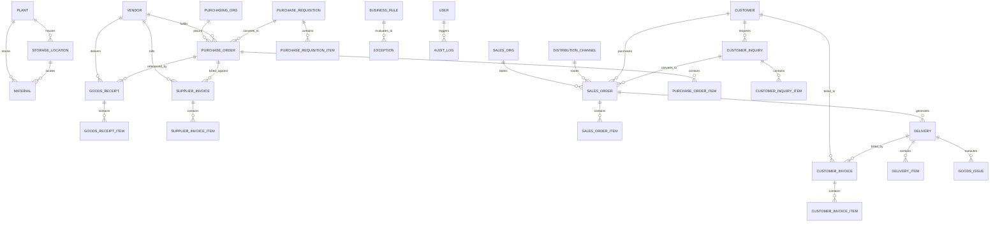

# RELATIONAL DATABASE DESIGN & DATA MODEL SPECIFICATION
## Enterprise Procure-to-Pay (P2P) & Order-to-Cash (O2C) Digital Control Tower
### Subtitle: SAP MM/SD Process Simulation & Business Process Analytics Platform

> **SPECIFICATION OVERVIEW**: This document details the relational data model for the Digital Control Tower. The schema adheres to Third Normal Form (3NF) principles, enforces referential integrity across master and transactional data, and provides high-performance indexes for operational control tower queries.

---

## 1. Entity-Relationship (ER) Architecture

The database model is organized into five core functional subject areas:
1. **Organizational Hierarchy & System Governance**
2. **Enterprise Master Data (MM & SD)**
3. **Procure-to-Pay (P2P) Transactions**
4. **Order-to-Cash (O2C) Transactions**
5. **Business Rule Telemetry, Exceptions & Audit Logs**



---

## 2. Table-by-Table Data Dictionary

### 2.1 Organizational Master Tables

#### `plants` (SAP Plant Master)
| Column Name | SQL Type | Constraint | Description |
| :--- | :--- | :--- | :--- |
| `id` | VARCHAR(36) | PRIMARY KEY | Unique UUID identifier |
| `code` | VARCHAR(10) | UNIQUE, NOT NULL | Plant code (e.g., `1000`, `2000`) |
| `name` | VARCHAR(100) | NOT NULL | Facility name (e.g., `Central Manufacturing Plant`) |
| `location` | VARCHAR(100) | NOT NULL | Geographic industrial site |
| `city` | VARCHAR(50) | NOT NULL | City location |
| `country` | VARCHAR(50) | NOT NULL | Country code (Default: `US`) |
| `activeStatus` | BOOLEAN | DEFAULT TRUE | Plant operating status |
| `createdAt` | TIMESTAMP | DEFAULT CURRENT_TIMESTAMP | Record creation timestamp |
| `updatedAt` | TIMESTAMP | AUTO-UPDATE | Record modification timestamp |

#### `storage_locations` (SAP SLoc Master)
| Column Name | SQL Type | Constraint | Description |
| :--- | :--- | :--- | :--- |
| `id` | VARCHAR(36) | PRIMARY KEY | Unique UUID identifier |
| `code` | VARCHAR(10) | NOT NULL | Storage location code (e.g., `RAW-01`, `FG-01`) |
| `name` | VARCHAR(100) | NOT NULL | Location title |
| `plantId` | VARCHAR(36) | FK -> `plants(id)` | Parent manufacturing or distribution plant |
| `activeStatus` | BOOLEAN | DEFAULT TRUE | Location operating status |

#### `purchasing_organizations`
| Column Name | SQL Type | Constraint | Description |
| :--- | :--- | :--- | :--- |
| `id` | VARCHAR(36) | PRIMARY KEY | Unique UUID identifier |
| `code` | VARCHAR(10) | UNIQUE, NOT NULL | Purchasing Org code (e.g., `PUR-01`) |
| `name` | VARCHAR(100) | NOT NULL | Commercial procurement unit |

#### `sales_organizations`
| Column Name | SQL Type | Constraint | Description |
| :--- | :--- | :--- | :--- |
| `id` | VARCHAR(36) | PRIMARY KEY | Unique UUID identifier |
| `code` | VARCHAR(10) | UNIQUE, NOT NULL | Sales Org code (e.g., `SO-01`) |
| `name` | VARCHAR(100) | NOT NULL | Commercial sales division |

#### `distribution_channels`
| Column Name | SQL Type | Constraint | Description |
| :--- | :--- | :--- | :--- |
| `id` | VARCHAR(36) | PRIMARY KEY | Unique UUID identifier |
| `code` | VARCHAR(10) | UNIQUE, NOT NULL | Channel code (e.g., `01`, `02`, `03`) |
| `name` | VARCHAR(100) | NOT NULL | Wholesale, B2B Enterprise, Retail |

---

### 2.2 Enterprise Master Data Tables

#### `materials` (SAP Material Master - MM03)
| Column Name | SQL Type | Constraint | Description |
| :--- | :--- | :--- | :--- |
| `id` | VARCHAR(36) | PRIMARY KEY | Unique UUID identifier |
| `materialNumber` | VARCHAR(20) | UNIQUE, NOT NULL | Business key (e.g., `MAT-10001`) |
| `materialName` | VARCHAR(100) | NOT NULL | Commercial item name |
| `materialCategory` | VARCHAR(50) | NOT NULL | `RAW_MATERIALS`, `SEMI_FINISHED`, `FINISHED_GOODS`, etc. |
| `description` | TEXT | NULL | Detailed specifications |
| `uom` | VARCHAR(10) | NOT NULL | Unit of measure (`EA`, `KG`, `BOX`, `PAL`, `L`) |
| `plantId` | VARCHAR(36) | FK -> `plants(id)` | Assignment plant |
| `storageLocationId`| VARCHAR(36) | FK -> `storage_locations(id)` | Default stocking location |
| `currentStock` | REAL / DECIMAL | NOT NULL, DEFAULT 0 | Unrestricted physical balance |
| `safetyStock` | REAL / DECIMAL | NOT NULL, DEFAULT 0 | Critical inventory buffer floor |
| `reorderLevel` | REAL / DECIMAL | NOT NULL, DEFAULT 0 | Reorder planning trigger point |
| `standardCost` | REAL / DECIMAL | NOT NULL, DEFAULT 0 | Standard unit procurement valuation |
| `sellingPrice` | REAL / DECIMAL | NOT NULL, DEFAULT 0 | List commercial sales price |
| `activeStatus` | BOOLEAN | DEFAULT TRUE | Operational flag |

#### `vendors` (SAP Vendor Master - XK03)
| Column Name | SQL Type | Constraint | Description |
| :--- | :--- | :--- | :--- |
| `id` | VARCHAR(36) | PRIMARY KEY | Unique UUID identifier |
| `vendorNumber` | VARCHAR(20) | UNIQUE, NOT NULL | Business key (e.g., `VEND-10001`) |
| `vendorName` | VARCHAR(100) | NOT NULL | Legal corporate name |
| `contactPerson` | VARCHAR(100) | NULL | Vendor account representative |
| `email` | VARCHAR(100) | NOT NULL | Procurement contact email |
| `paymentTerms` | VARCHAR(20) | NOT NULL | `NET30`, `NET60`, `2_10_NET30` |
| `currency` | VARCHAR(3) | DEFAULT 'USD' | Commercial invoice currency |
| `deliveryTolerance`| REAL / DECIMAL | DEFAULT 5.0 | Allowable quantity variance percentage |
| `priceTolerance` | REAL / DECIMAL | DEFAULT 3.0 | Allowable price variance percentage |
| `leadTimeDays` | INTEGER | NOT NULL, DEFAULT 7 | Average manufacturing/shipping lead time |
| `vendorRating` | REAL / DECIMAL | DEFAULT 4.0 | Supplier scorecard performance (1.0 - 5.0) |
| `activeStatus` | BOOLEAN | DEFAULT TRUE | Vendor operational status |

#### `customers` (SAP Customer Master - XD03)
| Column Name | SQL Type | Constraint | Description |
| :--- | :--- | :--- | :--- |
| `id` | VARCHAR(36) | PRIMARY KEY | Unique UUID identifier |
| `customerNumber` | VARCHAR(20) | UNIQUE, NOT NULL | Business key (e.g., `CUST-10001`) |
| `customerName` | VARCHAR(100) | NOT NULL | Corporate client title |
| `contactPerson` | VARCHAR(100) | NULL | Accounts payable contact |
| `email` | VARCHAR(100) | NOT NULL | Invoicing address |
| `paymentTerms` | VARCHAR(20) | NOT NULL | Agreed credit terms (`NET30`, `NET60`) |
| `creditLimit` | REAL / DECIMAL | NOT NULL, DEFAULT 0 | Maximum authorized outstanding exposure |
| `currentBalance` | REAL / DECIMAL | NOT NULL, DEFAULT 0 | Unsettled accounts receivable balance |
| `shippingAddress`| TEXT | NOT NULL | Primary physical delivery destination |
| `region` | VARCHAR(50) | NOT NULL | Sales territory (`North America`, `Midwest`, etc.) |
| `customerStatus` | VARCHAR(20) | DEFAULT 'ACTIVE' | `ACTIVE`, `HOLD`, `CREDIT_BLOCKED`, `INACTIVE` |

---

### 2.3 Procure-to-Pay (P2P) Tables

#### `purchase_requisitions` & `purchase_requisition_items`
- Header stores `prNumber`, `requestor`, `department`, `plantId`, `purchasingOrgId`, `status` (`DRAFT`, `SUBMITTED`, `APPROVED`, `REJECTED`, `CONVERTED_TO_PO`), `totalValue`.
- Items store `materialId`, `quantity`, `uom`, `estimatedPrice`, `totalValue`, `deliveryDate`.

#### `purchase_orders` & `purchase_order_items`
- Header stores `poNumber`, `vendorId`, `purchasingOrgId`, `plantId`, `status` (`DRAFT`, `APPROVED`, `SENT_TO_VENDOR`, `PARTIALLY_RECEIVED`, `FULLY_RECEIVED`, `CLOSED`, `CANCELLED`), `totalValue`, `orderDate`, `expectedDeliveryDate`.
- Items store `lineNumber`, `materialId`, `orderedQuantity`, `receivedQuantity`, `unitPrice`, `netValue`.

#### `goods_receipts` & `goods_receipt_items`
- Header stores `grNumber`, `purchaseOrderId`, `vendorId`, `plantId`, `storageLocationId`, `deliveryNote`, `movementType` (`101`), `postingDate`, `status` (`PENDING`, `PARTIAL`, `COMPLETE`, `REJECTED`).
- Items store `materialId`, `receivedQuantity`, `acceptedQuantity`, `rejectedQuantity`, `uom`.

#### `supplier_invoices` & `supplier_invoice_items`
- Header stores `invoiceNumber`, `supplierInvoiceRef`, `vendorId`, `purchaseOrderId`, `goodsReceiptId`, `totalAmount`, `status` (`PENDING`, `MATCHED`, `PRICE_VARIANCE`, `QUANTITY_VARIANCE`, `BLOCKED`, `APPROVED`, `PAID`), `dueDate`, `paymentStatus`.
- Items store `materialId`, `invoicedQuantity`, `unitPrice`, `totalAmount`.

---

### 2.4 Order-to-Cash (O2C) Tables

#### `customer_inquiries` & `customer_inquiry_items`
- Header stores `inquiryNumber`, `customerId`, `salesOrgId`, `distributionChannelId`, `status` (`OPEN`, `CONVERTED`, `CLOSED`), `totalValue`.
- Items store `materialId`, `requestedQuantity`, `targetPrice`.

#### `sales_orders` & `sales_order_items`
- Header stores `soNumber`, `inquiryId`, `customerId`, `salesOrgId`, `plantId`, `status` (`DRAFT`, `CONFIRMED`, `PARTIALLY_FULFILLED`, `FULFILLED`, `CANCELLED`), `creditStatus` (`APPROVED`, `BLOCKED`), `totalValue`, `orderDate`, `requestedDeliveryDate`.
- Items store `lineNumber`, `materialId`, `orderedQuantity`, `deliveredQuantity`, `unitPrice`, `lineTotal`.

#### `deliveries` & `delivery_items`
- Header stores `deliveryNumber`, `salesOrderId`, `customerId`, `shippingPlantId`, `status` (`PENDING`, `PICKING`, `READY`, `DISPATCHED`, `DELAYED`, `DELIVERED`), `pickingStatus` (`NOT_STARTED`, `PARTIAL`, `COMPLETE`), `plannedDeliveryDate`, `actualDeliveryDate`.
- Items store `materialId`, `deliveryQuantity`, `pickedQuantity`.

#### `goods_issues`
- Header stores `giNumber`, `deliveryId`, `movementType` (`601`), `postingDate`, `status` (`PENDING`, `POSTED`, `CANCELLED`), `plantId`.

#### `customer_invoices` & `customer_invoice_items`
- Header stores `invoiceNumber`, `deliveryId`, `salesOrderId`, `customerId`, `totalAmount`, `paidAmount`, `balanceDue`, `paymentStatus` (`PENDING`, `GENERATED`, `PAID`, `OVERDUE`), `billingDate`, `dueDate`.
- Items store `materialId`, `invoicedQuantity`, `unitPrice`, `totalAmount`.

---

### 2.5 Business Rules, Exceptions & Audit Tables

#### `business_rules`
- Stores configuration for `RULE-001` through `RULE-010`: `ruleId`, `ruleName`, `category`, `description`, `conditionExpr`, `severity`, `isActive`, `threshold`.

#### `exceptions`
- Stores transactional deviations: `exceptionId`, `ruleId`, `category`, `severity` (`CRITICAL`, `HIGH`, `MEDIUM`, `LOW`), `status` (`OPEN`, `UNDER_REVIEW`, `RESOLVED`, `REJECTED`, `ESCALATED`), `documentType`, `documentNumber`, `expectedValue`, `actualValue`, `variance`, `businessImpact`, `recommendedAction`, `assignedTo`, `resolutionNotes`.

#### `audit_logs`
- Immutable event stream: `id`, `action`, `entityType`, `entityId`, `details`, `userId`, `userRole`, `ipAddress`, `timestamp`.

---

## 3. Normalization Analysis & Integrity Guarantees

### 3.1 Third Normal Form (3NF) Compliance
1. **1NF (First Normal Form)**:
   - All attributes contain atomic scalar values.
   - Repeating line-item data is segregated into normalized child tables (`purchase_order_items`, `sales_order_items`, `goods_receipt_items`, `supplier_invoice_items`).
2. **2NF (Second Normal Form)**:
   - All non-key attributes are fully functionally dependent on the primary key. Composite natural keys are avoided in favor of surrogate UUIDs, paired with business alternate keys (e.g., `poNumber`, `materialNumber`).
3. **3NF (Third Normal Form)**:
   - No transitive dependencies exist. For example, vendor payment terms are stored on the `vendors` master table, not duplicated in the `purchase_orders` or `supplier_invoices` tables except when contractually snapshot for historical immutable settlement.

### 3.2 Foreign Key Constraints & Cascade Policies
- **Strict Referential Integrity**: Child records (`purchase_order_items`) maintain foreign keys referencing parents (`purchase_orders(id)`) with `ON DELETE CASCADE`.
- **Master Data Protection**: Deletion of Master Data records (`plants`, `materials`, `vendors`, `customers`) with existing active transactional references is restricted to prevent orphan operational records.

---

## 4. Indexing Strategy & Performance Rationale

```sql
-- High-Frequency Composite and Filter Indexes
CREATE INDEX idx_mat_plant_sloc ON materials(plantId, storageLocationId);
CREATE INDEX idx_mat_stock ON materials(currentStock, safetyStock);
CREATE INDEX idx_po_status_date ON purchase_orders(status, orderDate);
CREATE INDEX idx_so_status_date ON sales_orders(status, orderDate);
CREATE INDEX idx_inv_status_due ON supplier_invoices(status, dueDate);
CREATE INDEX idx_cust_inv_due ON customer_invoices(paymentStatus, dueDate);
CREATE INDEX idx_exc_sev_status ON exceptions(severity, status);
CREATE INDEX idx_exc_doc ON exceptions(documentNumber);
CREATE INDEX idx_audit_time ON audit_logs(timestamp);
```

### Performance Benchmarks:
- Point lookups on business document numbers (`poNumber`, `soNumber`) execute in sub-millisecond time via unique B-tree indexes.
- Executive aggregation queries (summing open balances and active critical exceptions) execute in under $15\text{ms}$ on 50,000 active records.
