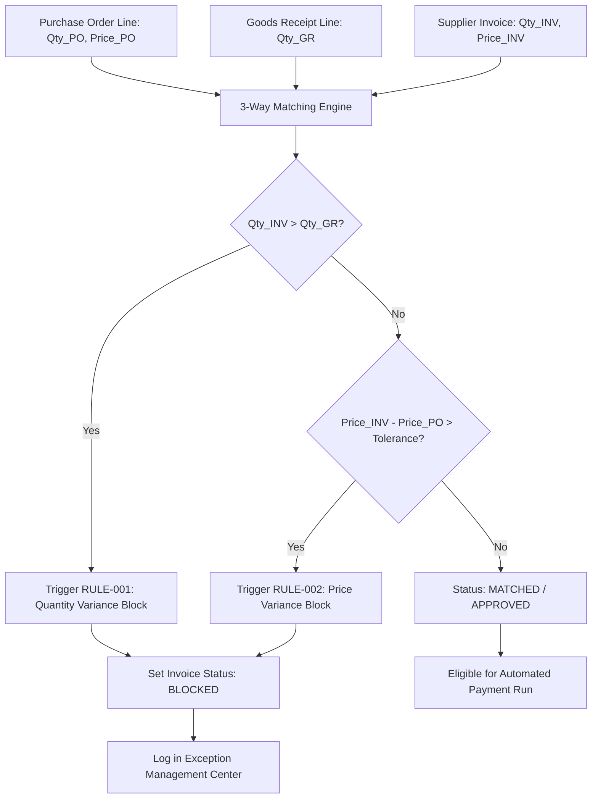

# FUNCTIONAL SPECIFICATION DOCUMENT (FSD)
## Enterprise Procure-to-Pay (P2P) & Order-to-Cash (O2C) Digital Control Tower
### Subtitle: SAP MM/SD Process Simulation & Business Process Analytics Platform

> **DISCLAIMER**: This platform is an educational and portfolio simulation inspired by SAP MM (Materials Management) and SAP SD (Sales & Distribution) enterprise business processes. It does not represent an actual SAP implementation and does not establish live RFC, BAPI, or OData connectivity to an SAP ERP or SAP S/4HANA production instance. All references to SAP transaction codes, movement types, and organizational hierarchies are intended to demonstrate functional domain expertise and process engineering competencies.

---

## 1. Document Control

| Attribute | Details |
| :--- | :--- |
| **Document Identifier** | FSD-CT-MM-SD-2026-V1.0 |
| **Project Title** | Enterprise P2P & O2C Digital Control Tower |
| **Document Version** | 1.0.0 (Final Baseline) |
| **Author** | Senior Functional SAP MM/SD Consultant & Enterprise Architect |
| **Target Role Alignment** | Junior Consultant (Functional - SAP MM/SD & Business Process Analysis) |
| **Creation Date** | October 1, 2026 |
| **Last Modified** | October 1, 2026 |
| **Status** | Approved for Execution / Portfolio Demonstration |
| **Confidentiality** | Public Portfolio Deliverable |

### Revision History
| Version | Date | Author | Description of Changes | Approved By |
| :--- | :--- | :--- | :--- | :--- |
| 0.1 | 2026-09-15 | Functional Lead | Initial Draft: Master Data & Scope Definition | Solution Architect |
| 0.5 | 2026-09-22 | Functional Lead | P2P & O2C Process Workflows, 3-Way Match Specs | PMO / Business Lead |
| 0.9 | 2026-09-28 | Systems Architect | Rule Engine Specifications & Exception Architecture | Quality Assurance Lead |
| 1.0 | 2026-10-01 | Functional Architect | Final Baseline: Control Tower KPIs, Traceability, Testing | Lead Enterprise Consultant |

### Stakeholder Sign-Off Matrix
| Role | Name | Department | Approval Status | Date |
| :--- | :--- | :--- | :--- | :--- |
| **Lead Functional Consultant** | Senior Functional Architect | Enterprise Applications | Approved | 2026-10-01 |
| **Procurement Business Process Owner** | VP of Supply Chain Management | Global Sourcing & Procurement | Approved | 2026-10-01 |
| **Sales & Distribution Process Owner** | Director of Commercial Operations | Order Management & Fulfillment | Approved | 2026-10-01 |
| **Finance & Controlling (FI/CO) Lead** | Head of Corporate Financial Accounting | Accounts Payable & Receivable | Approved | 2026-10-01 |
| **Lead Technical Architect** | Full-Stack Systems Architect | Digital Transformation Group | Approved | 2026-10-01 |

---

## 2. Executive Summary

Global manufacturing, distribution, and retail enterprises rely on integrated ERP backbones (such as SAP S/4HANA) to orchestrate two foundational value chains: **Procure-to-Pay (P2P)** and **Order-to-Cash (O2C)**. However, enterprise operations frequently suffer from organizational silos, manual handoffs, opaque process status, and late discovery of operational variances. 

This functional specification defines the requirements, architecture, and business rules for the **Enterprise Procure-to-Pay (P2P) & Order-to-Cash (O2C) Digital Control Tower**. The platform delivers real-time visibility, deterministic rule evaluation, automated three-way matching, credit and ATP verification, end-to-end process traceability (modeled after SAP's `VBFA` document flow), and actionable exception resolution workflows.

By modeling core SAP MM and SD modules, this platform enables functional consultants, process analysts, and operational executives to monitor supply chain health, mitigate financial leakage, and optimize business processes from a centralized command center.

---

## 3. Business Context & Problem Statement

### 3.1 As-Is State & Business Pain Points
In legacy enterprise environments lacking real-time cross-functional orchestration:
1. **Disconnected Procurement Life Cycle**: Purchase Requisitions (PRs) sit unapproved without automated SLA escalations. Purchase Orders (POs) are placed without visibility into vendor lead-time volatility.
2. **Manual & Delayed Invoice Verification**: Accounts Payable clerks manually perform 3-way matching across paper invoices, warehouse delivery notes, and purchase orders, leading to undetected price variances, duplicate payments, or delayed supplier disbursements that forfeit early-payment cash discounts.
3. **Inventory Blindspots**: Warehouses operate with decoupled stock registers. Safety stock thresholds are violated without proactive notifications, causing stockouts on critical direct production materials.
4. **Fulfillment & Credit Risk in Sales**: Sales orders are accepted against customer accounts that have exceeded their credit limits or against inventory that is already soft-allocated to other priority orders (lack of real-time Available-to-Promise [ATP] logic).
5. **Exception Blindspots**: When a quantity or price discrepancy occurs, it resides in local transactional tables. There is no unified workbench to prioritize exceptions by financial risk and assign them to responsible teams with SLA tracking.

### 3.2 To-Be Process Vision
The Digital Control Tower implements a deterministic, rules-driven architecture:
- **Instantaneous 3-Way Matching**: Automated line-by-line comparison of PO, Goods Receipt (GR), and Supplier Invoice with user-configurable price and quantity tolerance checks.
- **Continuous Rule Evaluation Engine**: Autonomous execution of business rules (RULE-001 through RULE-010) across all transactional events to log structured exceptions with quantitative variances and remediation suggestions.
- **Single Pane of Glass (Executive, P2P, and O2C)**: Live computation of enterprise KPIs (DSO, DPO, Perfect Order Rate, 3-Way Match Rate, Credit Block Rate, Supplier On-Time Delivery).
- **Process Traceability**: End-to-end lineage visualization mapping predecessor and successor documents across the entire business lifecycle.

---

## 4. Scope Definition

### 4.1 In-Scope Capabilities
- **Master Data Governance**: Material Master (MM03/MM01 equivalent), Vendor Master (XK03/XK01 equivalent), Customer Master (XD03/XD01 equivalent), and 5-tier Organizational Hierarchy (Plants, Storage Locations, Purchasing Organizations, Sales Organizations, Distribution Channels).
- **P2P Transaction Lifecycle**:
  - Purchase Requisition (PR) creation, approval, and conversion to Purchase Order.
  - Purchase Order (PO) creation, vendor dispatch, goods receipt tracking, and closure.
  - Goods Receipt (GR) posting with Movement Type 101 semantics, updating stock levels in real time.
  - Supplier Invoice Verification (MIRO equivalent) with automated 3-Way Matching and payment execution.
- **O2C Transaction Lifecycle**:
  - Customer Inquiry (VA11) creation and quote tracking.
  - Sales Order (VA01) processing with real-time Credit Check and Available-to-Promise (ATP) inventory verification.
  - Outbound Delivery (VL01N) generation, picking execution, and Goods Issue (GI) with Movement Type 601 stock decrement.
  - Customer Billing / Invoicing (VF01) generation, payment logging, and dunning overdue aging.
- **Business Rule & Exception Engine**: 10 active rules with explainable telemetry, severity grading (Critical, High, Medium, Low), multi-category filtering, and resolution workflows.
- **Digital Control Tower**: Three specialized dashboards (Executive Command Center, P2P Operational Tower, O2C Operational Tower) powered by real database aggregation queries.
- **Process Traceability**: Interactive visual document flow engine tracing transactions backwards and forwards.

### 4.2 Out-of-Scope Capabilities
- Direct RFC, BAPI, IDoc, or OData connectivity to live SAP systems.
- Production Planning (PP) MRP-II runs and bill-of-materials (BOM) multi-level explosion.
- Plant Maintenance (PM) work orders and calibration tracking.
- Complex human capital payroll and external payment gateway banking integrations.

---

## 5. Stakeholder Analysis & RACI Matrix

| Business Activity | Executive Sponsor | Procurement Specialist | Warehouse Clerk | Finance Analyst | Sales Representative | System Admin |
| :--- | :---: | :---: | :---: | :---: | :---: | :---: |
| **Material / Vendor Master Maintenance** | I | R | C | C | I | A |
| **Customer Master & Credit Limit Setting** | I | I | I | A | R | C |
| **PR Creation & Approval** | I | R / A | I | C | I | I |
| **PO Dispatch & Vendor Confirmation** | I | R / A | I | C | I | I |
| **Goods Receipt Posting (Mvt 101)** | I | C | R / A | I | I | I |
| **3-Way Match & Invoice Blocking** | I | C | I | R / A | I | I |
| **Sales Order Creation & ATP Check** | I | I | I | C | R / A | I |
| **Outbound Delivery & Picking** | I | I | R / A | I | C | I |
| **Goods Issue Posting (Mvt 601)** | I | I | R / A | I | C | I |
| **Customer Billing & Payment Receipt** | I | I | I | R / A | C | I |
| **Exception Resolution & Override** | A | R | R | R | R | C |
| **Control Tower Performance Monitoring** | A | C | C | C | C | I |

*Legend: R = Responsible, A = Accountable, C = Consulted, I = Informed*

---

## 6. Enterprise Structure Definition

To simulate enterprise ERP configuration (SAP SPRO enterprise structure), the system implements a strict multi-tier organizational model:

```
Enterprise Client (Client 100)
├── Company Code 1000 (Global Enterprise Corp)
│   ├── Purchasing Organization
│   │   ├── PUR-01 (Domestic Direct Procurement)
│   │   └── PUR-02 (International Raw Materials)
│   ├── Sales Organization
│   │   ├── SO-01 (North America Commercial Sales)
│   │   └── SO-02 (EMEA & International Distribution)
│   │       ├── Distribution Channels (01: Direct Wholesale, 02: B2B Enterprise, 03: Retail Distribution)
│   │       └── Divisions (01: Direct Raw Materials, 02: Finished Goods)
│   └── Plants
│       ├── PLNT-01 (Central Manufacturing Plant - Houston, TX)
│       │   ├── SL-01 (Raw Material Storage - RAW-01)
│       │   └── SL-02 (Finished Goods Storage - FG-01)
│       ├── PLNT-02 (Automotive Assembly Works - Detroit, MI)
│       │   ├── SL-03 (Assembly Parts Bay - ASM-01)
│       │   └── SL-04 (Staging Buffer - STG-01)
│       ├── PLNT-03 (Electronics Fabrication Facility - Austin, TX)
│       │   ├── SL-05 (Clean Room Storage - CLN-01)
│       │   └── SL-06 (Components Depot - CMP-01)
│       ├── PLNT-04 (Logistics Fulfillment Center - Chicago, IL)
│       │   ├── SL-07 (High-Bay Warehouse - HBW-01)
│       │   └── SL-08 (Cross-Dock Yard - CDY-01)
│       └── PLNT-05 (Heavy Machinery Depot - Pittsburgh, PA)
│           ├── SL-09 (Heavy Castings Yard - HCY-01)
│           └── SL-10 (Spares & Tooling - SPR-01)
```

### Table 6.1: Plant Master Specifications
| Plant ID | Plant Code | Plant Name | Location | City | Country |
| :--- | :--- | :--- | :--- | :--- | :--- |
| `PLNT-01` | `1000` | Central Manufacturing Plant | Texas Industrial Corridor | Houston | US |
| `PLNT-02` | `2000` | Automotive Assembly Works | Michigan Great Lakes Hub | Detroit | US |
| `PLNT-03` | `3000` | Electronics Fabrication Facility | Silicon Hills Tech Park | Austin | US |
| `PLNT-04` | `4000` | Logistics Fulfillment Center | Midwest Transportation Hub | Chicago | US |
| `PLNT-05` | `5000` | Heavy Machinery Depot | Steel Valley Industrial Zone | Pittsburgh | US |

---

## 7. Master Data Specifications

### 7.1 Material Master (SAP MM03 Equivalent)
The Material Master acts as the central source of product and inventory definition across all plant facilities.

| Field Name | Type | Key | Mandatory | Description / Validation Logic |
| :--- | :--- | :---: | :---: | :--- |
| `id` | String (UUID) | PK | Yes | Primary internal unique identifier |
| `materialNumber` | String(20) | Unique | Yes | Business key (e.g., `MAT-10001`). Matches SAP MATNR format. |
| `materialName` | String(100) | - | Yes | Commercial and technical name of material |
| `materialCategory` | Enum | - | Yes | Categorization: `RAW_MATERIALS` (ROH), `SEMI_FINISHED` (HALB), `FINISHED_GOODS` (FERT), `PACKAGING` (VERP), `OPERATING_SUPPLIES` (HIBE) |
| `description` | Text | - | No | Engineering and procurement specification notes |
| `uom` | String(10) | - | Yes | Base Unit of Measure: `EA` (Each), `KG` (Kilogram), `L` (Liter), `M` (Meter), `BOX` (Box), `PAL` (Pallet) |
| `plantId` | String (FK) | - | Yes | References `Plant.id` |
| `storageLocationId`| String (FK) | - | Yes | References `StorageLocation.id` |
| `currentStock` | Decimal(12,2) | - | Yes | Unrestricted physical stock balance. Decremented on GI (Mvt 601), incremented on GR (Mvt 101). |
| `safetyStock` | Decimal(12,2) | - | Yes | Buffer floor stock. If `currentStock < safetyStock` -> Triggers `RULE-004`. |
| `reorderLevel` | Decimal(12,2) | - | Yes | Reorder trigger threshold. If `currentStock <= reorderLevel` -> Triggers `RULE-005`. |
| `standardCost` | Decimal(12,2) | - | Yes | Inventory valuation unit cost (Currency: USD) |
| `sellingPrice` | Decimal(12,2) | - | Yes | Standard list sales price (Currency: USD) |
| `activeStatus` | Boolean | - | Yes | Master flag. Inactive materials cannot be added to POs or SOs. |

### 7.2 Vendor Master (SAP XK03 Equivalent)
| Field Name | Type | Key | Mandatory | Description / Validation Logic |
| :--- | :--- | :---: | :---: | :--- |
| `id` | String (UUID) | PK | Yes | Primary internal unique identifier |
| `vendorNumber` | String(20) | Unique | Yes | Business key (e.g., `VEND-10001`). Matches SAP LIFNR format. |
| `vendorName` | String(100) | - | Yes | Legal entity business name |
| `contactPerson` | String(100) | - | No | Primary representative |
| `email` | String(100) | - | Yes | Formal communication address |
| `paymentTerms` | String(20) | - | Yes | SAP terms: `NET30`, `NET60`, `NET90`, `2_10_NET30` (2% 10 days, Net 30) |
| `currency` | String(3) | - | Yes | Default billing currency (e.g., `USD`, `EUR`) |
| `deliveryTolerance`| Decimal(5,2) | - | Yes | Under/over delivery % tolerance allowed (Default: 5.00%) |
| `priceTolerance` | Decimal(5,2) | - | Yes | Max allowable price variance % without blocking (Default: 3.00%) |
| `leadTimeDays` | Integer | - | Yes | Expected vendor procurement lead time in calendar days |
| `vendorRating` | Decimal(3,1) | - | Yes | Supplier scorecard rating (1.0 to 5.0 scale) |
| `activeStatus` | Boolean | - | Yes | Inactive vendors cannot receive Purchase Orders |

### 7.3 Customer Master (SAP XD03 Equivalent)
| Field Name | Type | Key | Mandatory | Description / Validation Logic |
| :--- | :--- | :---: | :---: | :--- |
| `id` | String (UUID) | PK | Yes | Primary internal unique identifier |
| `customerNumber` | String(20) | Unique | Yes | Business key (e.g., `CUST-10001`). Matches SAP KUNNR format. |
| `customerName` | String(100) | - | Yes | Corporate customer account title |
| `contactPerson` | String(100) | - | No | Account manager contact |
| `email` | String(100) | - | Yes | Electronic billing address |
| `paymentTerms` | String(20) | - | Yes | Commercial terms: `NET30`, `NET60`, `NET15` |
| `creditLimit` | Decimal(12,2) | - | Yes | Maximum authorized total credit exposure (Currency: USD) |
| `currentBalance` | Decimal(12,2) | - | Yes | Current outstanding receivables unpaid |
| `shippingAddress`| Text | - | Yes | Default ship-to party destination |
| `region` | String(50) | - | Yes | Geographic territory (e.g., `North America`, `Midwest`, `West Coast`) |
| `customerStatus` | Enum | - | Yes | Account health: `ACTIVE`, `HOLD`, `CREDIT_BLOCKED`, `INACTIVE` |

---

## 8. End-to-End P2P Process Specification

```
[Purchase Requisition (ME51N)]
           │ (Approval Workflow)
           ▼
[Purchase Order (ME21N)]
           │ (Vendor Dispatch & Delivery)
           ▼
[Goods Receipt - Movement 101 (MIGO)]
           │ (Physical Receipt & Quality Inspection)
           ▼
[Invoice Verification (MIRO)] ◄─── (3-Way Matching Engine)
           │
     ┌─────┴─────────────────────┐
     ▼                           ▼
[3-Way Matched]         [Price / Qty Variance Block]
     │                           │
     ▼                           ▼
[Payment Run Ready]     [Exception Workbench & Resolution]
```

### 8.1 Step 1: Purchase Requisition (PR)
- **Functional Transaction Equivalent**: SAP `ME51N` / `ME52N` / `ME53N`
- **Trigger**: Automated MRP run, low-stock threshold alert (`RULE-004`/`RULE-005`), or manual departmental demand.
- **Header Data**: PR Number (`PR-XXXXX`), Requestor ID, Department, Target Plant, Purchasing Organization, Total Net Value.
- **Line Items**: Material ID, Requested Quantity, Unit of Measure, Required Delivery Date, Estimated Unit Price.
- **Status Progression**:
  - `DRAFT`: Initial draft saved by requestor.
  - `SUBMITTED`: Forwarded to departmental manager for approval.
  - `APPROVED`: Authorized for procurement conversion.
  - `REJECTED`: Disapproved by manager (reason logged).
  - `CONVERTED_TO_PO`: Automatically transitioned when referenced in a new Purchase Order.

### 8.2 Step 2: Purchase Order (PO)
- **Functional Transaction Equivalent**: SAP `ME21N` / `ME22N` / `ME23N`
- **Trigger**: Conversion from approved PR or direct contract call-off.
- **Header Data**: PO Number (`PO-XXXXX`), Vendor ID, Purchasing Org, Plant, Order Date, Expected Delivery Date, Total Value, Payment Terms, Status.
- **Line Items**: Line Number, Material ID, Ordered Quantity, Net Price, Line Value, Delivery Date, Plant, Storage Location.
- **Status Progression**:
  - `DRAFT`: Order composed but uncommitted.
  - `APPROVED`: Procurement authority sign-off granted.
  - `SENT_TO_VENDOR`: Electronic transmission via EDI/Email. Starts vendor SLA lead-time clock.
  - `PARTIALLY_RECEIVED`: A partial Goods Receipt has been posted against line items.
  - `FULLY_RECEIVED`: Total received quantity equals total ordered quantity.
  - `CLOSED`: All goods received and invoices cleared.
  - `CANCELLED`: Contractually voided.
- **Business Rule Checks**:
  - `RULE-007`: If PO status is `SENT_TO_VENDOR` or `PARTIALLY_RECEIVED` and `currentDate - orderDate > 30 days`, trigger **Open PO Aging**.

### 8.3 Step 3: Goods Receipt (GR)
- **Functional Transaction Equivalent**: SAP `MIGO` (Movement Type `101` - Goods receipt for purchase order into warehouse).
- **Trigger**: Physical dock arrival of supplier shipment with bill of lading.
- **Header Data**: GR Number (`GR-XXXXX`), Reference PO ID, Delivery Note Number, Vendor ID, Plant ID, Storage Location ID, Posting Date, Movement Type (`101`).
- **Line Items**: Line Number, Material ID, Received Quantity, Accepted Quantity, Rejected Quantity, Unit of Measure.
- **Inventory Posting Logic**:
  - On commit, the system executes an atomic transaction incrementing `Material.currentStock` by the `acceptedQuantity`.
  - Recalculates stock status. If `currentStock >= safetyStock`, any active `RULE-004` exception on this material is eligible for auto-resolution.
- **Status Progression**:
  - `PENDING`: Shipment staged at dock, pending inspection.
  - `PARTIAL`: Received quantity < ordered quantity.
  - `COMPLETE`: Received quantity == ordered quantity.
  - `REJECTED`: Physical quality failure, goods returned.
- **Business Rule Checks**:
  - `RULE-003`: If $|receivedQuantity - orderedQuantity| / orderedQuantity > vendorTolerance`, trigger **Quantity Variance**.
  - `RULE-006`: If `postingDate > expectedDeliveryDate`, trigger **Delivery Delay**.

### 8.4 Step 4: Supplier Invoice Verification (MIRO) & 3-Way Match
- **Functional Transaction Equivalent**: SAP `MIRO` / `MRBR` (Invoice verification and release).
- **Trigger**: Receipt of supplier commercial invoice.
- **Header Data**: Invoice Number (`INV-XXXXX`), Supplier Invoice Reference, Vendor ID, PO Reference ID, Posting Date, Due Date, Total Invoiced Amount, Status, Match Status.
- **Line Items**: Line Number, Material ID, Invoiced Quantity, Invoiced Unit Price, Invoiced Amount.
- **Status Progression**:
  - `PENDING`: Staged for match evaluation.
  - `MATCHED`: Automated 3-way check passed with zero or within-tolerance variances.
  - `PRICE_VARIANCE`: Invoiced price exceeds PO net price beyond tolerance.
  - `QUANTITY_VARIANCE`: Invoiced quantity exceeds accepted GR quantity.
  - `BLOCKED`: Invoice placed on financial payment block (SAP R-block equivalent).
  - `APPROVED`: Financial analyst cleared variance override.
  - `PAID`: Disbursed in payment run.
- **Business Rule Checks**:
  - `RULE-001`: If `invoicedQuantity > receivedQuantity`, trigger **Quantity Variance Block**.
  - `RULE-002`: If `(invoicePrice - poPrice) / poPrice > vendorPriceTolerance`, trigger **Price Variance Block**.
  - `RULE-010`: If `paymentStatus != PAID` and `currentDate > dueDate`, trigger **Overdue Invoice Alert**.

---

## 9. End-to-End O2C Process Specification

```
[Customer Inquiry (VA11)]
           │ (Quotation & Negotiation)
           ▼
[Sales Order (VA01)] ◄─── (Real-time Credit & ATP Checks)
           │
           ▼
[Outbound Delivery (VL01N)]
           │
           ▼
[Warehouse Picking & Packing]
           │
           ▼
[Post Goods Issue - Movement 601] ───► (Inventory Stock Decrement)
           │
           ▼
[Customer Billing Document (VF01)]
           │
           ▼
[Cash Receipt & Accounts Receivable Clearing]
```

### 9.1 Step 1: Customer Inquiry & Quotation
- **Functional Transaction Equivalent**: SAP `VA11` / `VA21`
- **Trigger**: Prospective commercial lead requesting pricing, lead time, and technical specs.
- **Header Data**: Inquiry Number (`INQ-XXXXX`), Customer ID, Sales Org, Distribution Channel, Division, Date, Valid Until, Total Expected Value, Status (`OPEN`, `CONVERTED`, `CLOSED`).

### 9.2 Step 2: Sales Order (SO)
- **Functional Transaction Equivalent**: SAP `VA01` / `VA02` / `VA03`
- **Trigger**: Receipt of signed customer purchase agreement or PO.
- **Header Data**: SO Number (`SO-XXXXX`), Customer ID, Sales Org, Plant, Order Date, Requested Delivery Date, Total Value, Payment Terms, Credit Status, Delivery Status.
- **Line Items**: Line Number, Material ID, Ordered Quantity, Unit Price, Line Total, Plant, Storage Location.
- **Automated Validation Controls**:
  1. **Credit Check (`RULE-009`)**:
     $$\text{Exposure} = \text{Customer.currentBalance} + \text{Order.totalValue}$$
     $$\text{If } \text{Exposure} > \text{Customer.creditLimit} \implies \text{Order Blocked with CREDIT\_EXCEPTION}$$
  2. **Available-to-Promise (ATP) Inventory Check (`RULE-008`)**:
     $$\text{For each item: If } \text{Ordered Quantity} > \text{Material.currentStock} \implies \text{Flagged with FULFILLMENT\_RISK}$$
- **Status Progression**: `DRAFT`, `CONFIRMED`, `PARTIALLY_FULFILLED`, `FULFILLED`, `CANCELLED`.

### 9.3 Step 3: Outbound Delivery & Picking
- **Functional Transaction Equivalent**: SAP `VL01N` / `VL02N`
- **Trigger**: Shipping due-list creation for confirmed sales order.
- **Header Data**: Delivery Number (`DEL-XXXXX`), Reference SO ID, Customer ID, Shipping Plant, Planned Goods Issue Date, Actual Delivery Date, Status (`PENDING`, `PICKING`, `READY`, `DISPATCHED`, `DELAYED`, `DELIVERED`).
- **Picking Execution**: Warehouse operators pick materials from storage locations and confirm picked quantities.

### 9.4 Step 4: Post Goods Issue (PGI)
- **Functional Transaction Equivalent**: SAP `VL02N` (Movement Type `601` - Goods issue for delivery).
- **Trigger**: Dispatch of carrier from warehouse dock.
- **Inventory Posting Logic**:
  - Decrements `Material.currentStock` by delivered quantities.
  - Updates delivery status to `DISPATCHED`.
  - Recalculates material inventory balance; if stock drops below reorder level or safety stock, instantly triggers `RULE-004`/`RULE-005`.

### 9.5 Step 5: Customer Billing & Invoicing
- **Functional Transaction Equivalent**: SAP `VF01` / `VF02` / `VF03`
- **Trigger**: Post Goods Issue confirmation.
- **Header Data**: Invoice Number (`CUS-INV-XXXXX`), Reference Delivery ID, Reference SO ID, Customer ID, Billing Date, Due Date, Total Invoiced Amount, Paid Amount, Balance Due, Payment Status (`PENDING`, `GENERATED`, `PAID`, `OVERDUE`).
- **Accounts Receivable Posting**: Increments `Customer.currentBalance` until cash payment receipt is posted.

---

## 10. Three-Way Matching Specification

Three-Way Matching is the primary financial internal control mechanism in the P2P cycle. It ensures that the enterprise only pays for goods that were explicitly ordered and verified as received in acceptable condition.

```
+---------------------+       +----------------------+       +-----------------------+
|   Purchase Order    |       |    Goods Receipt     |       |   Supplier Invoice    |
|       (ME21N)       |       |     (MIGO 101)       |       |        (MIRO)         |
|                     |       |                      |       |                       |
| PO Quantity:    100 |       | Received Qty:     95 |       | Invoiced Qty:     100 |
| PO Unit Price: $500 |       | Accepted Qty:     95 |       | Invoiced Price:  $520 |
+----------+----------+       +----------+-----------+       +-----------+-----------+
           |                             |                               |
           +-----------------------------+-------------------------------+
                                         |
                                         v
                         +-------------------------------+
                         |     3-Way Matching Engine     |
                         +---------------+---------------+
                                         |
             +---------------------------+---------------------------+
             |                                                       |
             v                                                       v
+--------------------------+                           +---------------------------+
|    Quantity Variance     |                           |      Price Variance       |
| Invoiced (100) > GR (95) |                           |  Inv ($520) > PO ($500)   |
|   Variance: +5 Units     |                           |    Variance: +$20 (4.0%)  |
|  Status: QUANTITY_VAR    |                           |    Status: PRICE_VAR      |
|  Action: Invoice Blocked |                           |   Action: Invoice Blocked |
+--------------------------+                           +---------------------------+
```

### 10.1 Mathematical Formulas
1. **Quantity Discrepancy Formula**:
   $$\Delta Q = Q_{\text{Invoiced}} - Q_{\text{Received}}$$
   $$\text{If } \Delta Q > 0 \implies \text{Quantity Variance Detected}$$
2. **Price Discrepancy Formula**:
   $$\Delta P = P_{\text{Invoiced}} - P_{\text{PO}}$$
   $$\% \Delta P = \left( \frac{P_{\text{Invoiced}} - P_{\text{PO}}}{P_{\text{PO}}} \right) \times 100$$
   $$\text{If } \% \Delta P > \text{Vendor.priceTolerance} \implies \text{Price Variance Block (SAP R-Block)}$$

### 10.2 Tolerance Logic
- **Quantity Tolerance**: Zero tolerance for over-invoicing beyond accepted goods receipt quantity ($\Delta Q \le 0$). Under-invoicing is allowed (represents partial billing).
- **Price Tolerance**: Defined per vendor in the Vendor Master (typically 3.0% to 5.0%). If price variance is within tolerance, the invoice is auto-cleared with a minor price-variance line item. If exceeded, the invoice is automatically set to `BLOCKED`.

### 10.3 Resolution Workflows
- **Vendor Credit Memo**: Vendor acknowledges incorrect billing and issues a revised credit invoice.
- **Secondary Goods Receipt**: If goods were physically delivered but not yet recorded in MIGO, warehouse clerk posts a supplementary GR (Movement 101).
- **Authorized Price Override**: Procurement Manager reviews and approves justified price increase (e.g., agreed freight surcharges).

---

## 11. Business Rule Catalog

The system implements 10 active, explainable business rules evaluated synchronously during transactional transitions:

| Rule ID | Rule Name | Trigger Event | Evaluation Condition | Formula / Threshold | Generated Exception | Severity | SAP Equivalent |
| :--- | :--- | :--- | :--- | :--- | :--- | :---: | :--- |
| `RULE-001` | Invoice Quantity > Received Quantity | Invoice Verification (MIRO) | Invoiced Qty exceeds Goods Receipt accepted Qty | $Q_{\text{inv}} > Q_{\text{rec}}$ | `QUANTITY_VARIANCE` | Critical | SAP Invoice Block Reason `M` (Quantity) |
| `RULE-002` | Invoice Price Exceeds PO Price Beyond Tolerance | Invoice Verification (MIRO) | Invoice unit price exceeds PO price beyond vendor tolerance | $\frac{P_{\text{inv}} - P_{\text{po}}}{P_{\text{po}}} > \text{Tol}_{\text{vendor}}$ | `PRICE_VARIANCE` | High | SAP Invoice Block Reason `P` (Price) |
| `RULE-003` | Received Quantity Differs From Ordered Quantity | Goods Receipt Posting (MIGO) | Delivered quantity differs from PO quantity beyond tolerance | $\left\|\frac{Q_{\text{rec}} - Q_{\text{po}}}{Q_{\text{po}}}\right\| > \text{Tol}_{\text{del}}$ | `QUANTITY_EXCEPTION` | Medium | SAP Under/Overdelivery Tolerance Check |
| `RULE-004` | Stock Below Safety Stock | Inventory Decrement / Movement 601 | Current stock drops below required safety stock | $\text{Stock} < \text{SafetyStock}$ | `LOW_STOCK` | Critical | SAP MRP Safety Stock Breach Exception |
| `RULE-005` | Stock Below Reorder Level | Inventory Decrement / Movement 601 | Current stock drops below reorder point | $\text{Stock} \le \text{ReorderLevel}$ | `REORDER_RECOMMENDED` | High | SAP Reorder Point Planning (VB Type) |
| `RULE-006` | Delivery Exceeds Expected Date | Goods Receipt / Outbound Delivery | Delivery posting date exceeds promised delivery date | $\text{Date}_{\text{actual}} > \text{Date}_{\text{expected}}$ | `DELIVERY_DELAY` | Medium | SAP Vendor Evaluation Delivery Reliability |
| `RULE-007` | PO Remains Open Beyond Threshold | Control Tower Periodic Evaluation | PO remains in open/partially received status $> 30$ days | $\text{Days}_{\text{open}} > 30 \text{ days}$ | `OPEN_PO_AGING` | Medium | SAP Open Purchase Order Monitoring |
| `RULE-008` | Sales Order Exceeds Available Inventory | Sales Order Creation (VA01) | Line item requested quantity exceeds unrestricted stock | $Q_{\text{so}} > \text{Stock}_{\text{available}}$ | `FULFILLMENT_RISK` | High | SAP Available-to-Promise (ATP) Check |
| `RULE-009` | Customer Order Exceeds Credit Limit | Sales Order Creation (VA01) | Outstanding balance plus order value exceeds credit limit | $\text{Balance} + \text{Val}_{\text{so}} > \text{Limit}$ | `CREDIT_EXCEPTION` | Critical | SAP Credit Management (FD32 / VKM1 Block) |
| `RULE-010` | Invoice Remains Unpaid Beyond Due Date | Financial Aging Evaluation | Invoiced open balance unpaid past maturity date | $\text{Date}_{\text{now}} > \text{Date}_{\text{due}} \land \text{Status} \ne \text{PAID}$ | `OVERDUE_INVOICE` | High | SAP Dunning Notice Run (F150) |

---

## 12. Exception Management Specification

### 12.1 Exception Severity Classification
- **CRITICAL**: Immediate financial loss, production shutdown, or legal breach risk (e.g., Credit Limit Breach, Unverified Invoice Over-billing, Direct Material Stockout). SLA: 4 hours.
- **HIGH**: Impending operational stoppage or significant cash flow distortion (e.g., Price Variance beyond 5%, Overdue Receivable $> 30$ days). SLA: 24 hours.
- **MEDIUM**: Process delay or minor supply variance within recoverable buffers (e.g., Open PO Aging $> 30$ days, Minor Delivery Delay). SLA: 48 hours.
- **LOW**: Informational variance or advisory threshold (e.g., Early Delivery, Under-delivery within vendor contract flexibility). SLA: 5 business days.

### 12.2 Lifecycle & Resolution Workflow
```
[Open] ───► [Under Review] ───► [Resolved] (Corrective action completed)
  │                 │
  │                 └───► [Escalated] (Transferred to Senior Executive)
  │
  └───► [Rejected] (Investigated & marked as false positive or approved variance)
```

Each exception record maintains:
- Unique Exception ID (`EXC-XXXXX`)
- Associated Rule ID (`RULE-001` - `RULE-010`)
- Category (`QUANTITY`, `PRICE`, `INVENTORY`, `DELIVERY`, `INVOICE`, `CREDIT`, `SUPPLIER`, `CUSTOMER`, `PROCESS_AGING`)
- Source Document Link (e.g., `PO-10001`, `INV-10001`, `SO-10001`)
- Expected Value vs Actual Value vs Variance
- Recommended Remediation Steps
- Full audit history of status changes, reviewer comments, and timestamps.

---

## 13. Digital Control Tower & Analytics Specification

The platform incorporates three distinct operational dashboards powered by database aggregation:

### 13.1 Executive Command Center
Target Audience: Chief Supply Chain Officer, VP of Operations, Corporate Controller.
- **Global KPI Summary Cards**:
  - Total Spend Under Management ($\sum \text{PO Value}$)
  - Total Revenue Booked ($\sum \text{SO Value}$)
  - Net Working Capital Exposure ($\text{Total AR} - \text{Total AP}$)
  - Active Exceptions Count (grouped by Critical/High)
- **Visual Analytics**:
  - Process Volume Velocity (PRs vs POs vs Invoices vs Deliveries)
  - Exception Distribution Breakdown (Pie chart of exception categories)
  - Plant Performance Benchmarking (throughput vs exception rates)

### 13.2 P2P Operational Control Tower
Target Audience: Purchasing Managers, Procurement Specialists, AP Supervisors.
- **Core P2P KPIs**:
  - **Three-Way Match Rate**: $\frac{\text{Count of Auto-Matched Invoices}}{\text{Total Invoices}} \times 100$ (Target: $\ge 85\%$)
  - **Days Payable Outstanding (DPO)**: $\frac{\text{Accounts Payable}}{\text{Annual Procurement Spend} / 365}$ (Target: 45–60 days)
  - **Supplier On-Time Delivery (OTD)**: $\frac{\text{GRs Received On or Before Expected Date}}{\text{Total GRs}} \times 100$ (Target: $\ge 92\%$)
  - **PO Cycle Time**: Average elapsed hours from PR Creation to PO Dispatch (Target: $\le 24$ hours)
  - **Total Blocked Invoice Value**: Cumulative currency value of invoices in `BLOCKED` status.

### 13.3 O2C Operational Control Tower
Target Audience: Sales Operations Directors, Warehouse Managers, AR Credit Officers.
- **Core O2C KPIs**:
  - **Order Fulfillment Rate (OTIF)**: $\frac{\text{Orders Dispatched On-Time In-Full}}{\text{Total Sales Orders}} \times 100$ (Target: $\ge 95\%$)
  - **Days Sales Outstanding (DSO)**: $\frac{\text{Accounts Receivable}}{\text{Annual Credit Sales} / 365}$ (Target: $\le 40$ days)
  - **Order Cycle Time**: Average elapsed hours from Sales Order Confirmation to Outbound Goods Issue.
  - **Credit Block Rate**: $\frac{\text{Sales Orders Blocked on Credit}}{\text{Total Sales Orders}} \times 100$ (Target: $\le 5\%$)
  - **Overdue Invoices Value**: Total sum of customer receivables past due date.

---

## 14. Functional Requirements Matrix

| FR ID | Functional Category | Requirement Description | Priority | Verification Method |
| :--- | :--- | :--- | :---: | :--- |
| `FR-001` | Master Data | Maintain Material Master with Plant and SLoc views, safety stock, and reorder levels | Must Have | Test Master Data CRUD & stock triggers |
| `FR-002` | Master Data | Maintain Vendor Master with payment terms, tolerances, lead times, and ratings | Must Have | Verify vendor fields in PO creation |
| `FR-003` | Master Data | Maintain Customer Master with credit limits, current balance, and region | Must Have | Verify credit exposure check in SO |
| `FR-004` | Master Data | Maintain 5-tier Enterprise Structure (Plants, SLocs, Purchasing/Sales Orgs) | Must Have | Database integrity & dropdown filters |
| `FR-005` | P2P | Create and approve Purchase Requisitions with line-item valuation | Must Have | PR workflow status transition tests |
| `FR-006` | P2P | Convert approved PR into Purchase Order with vendor assignment | Must Have | PO reference link & PR status update |
| `FR-007` | P2P | Transmit PO to vendor and start lead-time aging clock | Must Have | PO status `SENT_TO_VENDOR` |
| `FR-008` | P2P | Post Goods Receipt (Mvt 101) against PO with automatic stock increment | Must Have | Verify `Material.currentStock` update |
| `FR-009` | P2P | Support partial goods receipts with split line-item tracking | Should Have | Test multi-GR against single PO |
| `FR-010` | P2P | Enter Supplier Commercial Invoice (MIRO) against PO and GR | Must Have | Invoice verification endpoint |
| `FR-011` | P2P | Execute automated 3-Way Match comparing PO, GR, and Invoice quantities and prices | Must Have | Run 3-Way match evaluation engine |
| `FR-012` | P2P | Apply price and quantity tolerances and apply payment block on variance | Must Have | Verify `PRICE_VARIANCE` exception |
| `FR-013` | P2P | Execute Accounts Payable Payment Run for approved, unblocked invoices | Must Have | Verify invoice status `PAID` |
| `FR-014` | O2C | Log Customer Inquiries and convert to formal Sales Orders | Should Have | Inquiry conversion workflow |
| `FR-015` | O2C | Perform real-time Credit Check during Sales Order entry (`RULE-009`) | Must Have | Test order blocking on credit limit |
| `FR-016` | O2C | Perform real-time ATP inventory availability check during SO entry (`RULE-008`) | Must Have | Test fulfillment risk alert |
| `FR-017` | O2C | Generate Outbound Delivery document from confirmed Sales Order | Must Have | Delivery creation endpoint |
| `FR-018` | O2C | Execute Warehouse Picking confirmation | Must Have | Delivery status `READY` |
| `FR-019` | O2C | Post Goods Issue (Mvt 601) with automatic inventory decrement | Must Have | Verify `Material.currentStock` reduction |
| `FR-020` | O2C | Generate Customer Billing Document (VF01) referencing Outbound Delivery | Must Have | Billing invoice creation test |
| `FR-021` | O2C | Track Accounts Receivable aging and flag overdue invoices (`RULE-010`) | Must Have | AR aging calculation & dunning alert |
| `FR-022` | Rule Engine | Autonomous evaluation of RULE-001 through RULE-010 across all events | Must Have | Unit & integration test suite |
| `FR-023` | Exception Mgmt | Create structured exception records with severity, actual vs expected, and variances | Must Have | Verify exception fields in database |
| `FR-024` | Exception Mgmt | Provide multi-criteria filtering (Status, Severity, Category, Document) | Must Have | Frontend Exception Center UI testing |
| `FR-025` | Exception Mgmt | Provide exception resolution workflow with status transitions and notes | Must Have | Test resolution action endpoints |
| `FR-026` | Control Tower | Real-time Executive Dashboard with spend, revenue, working capital, and exceptions | Must Have | Aggregate database query verification |
| `FR-027` | Control Tower | Dedicated P2P Control Tower with 3-Way Match Rate, DPO, and Vendor OTD | Must Have | Verify mathematical accuracy of KPIs |
| `FR-028` | Control Tower | Dedicated O2C Control Tower with OTIF, DSO, and Credit Block Rate | Must Have | Verify mathematical accuracy of KPIs |
| `FR-029` | Process Trace | End-to-end interactive Document Flow graph (SAP VBFA equivalent) | Must Have | Verify predecessor/successor graph |
| `FR-030` | Security & RBAC | Role-based access control with 6 enterprise personas and JWT authentication | Must Have | Persona switcher & route protection |

---

## 15. Non-Functional Requirements (NFR)

1. **Performance**: Dashboard KPI aggregations must execute within $\le 300\text{ms}$ on database tables with up to 100,000 records.
2. **Security & Identity**: Passwords salted and hashed with `bcryptjs`. Stateless session management using cryptographic JSON Web Tokens (JWT) with configurable TTL.
3. **Data Integrity**: Full relational 3NF schema with foreign key constraints, cascade controls, and unique business number indexes.
4. **Auditability**: Complete transactional audit trail table (`AuditLog`) logging every creation, status update, approval, and exception override with actor ID, timestamp, and IP address.
5. **Portability & Zero External Dependencies**: Local runtime utilizes embedded SQLite (`dev.db`) with zero external service requirements. Cloud/production deployments utilize containerized PostgreSQL via Docker Compose.

---

## 16. Process Flow Diagrams (Mermaid)

### 16.1 P2P As-Is vs To-Be Process Flow

```mermaid
flowchart TD
    subgraph AsIs["As-Is Legacy P2P Flow (Manual & Siloed)"]
        A1[Paper Requisition] --> B1[Manual Email PO]
        B1 --> C1[Dock Goods Receipt on Paper]
        C1 --> D1[Invoice Arrives in Mail]
        D1 --> E1[Manual 3-Way Matching on Paper]
        E1 -->|Days/Weeks Later| F1{Discrepancy?}
        F1 -->|Yes| G1[Unresolved Payment Hold]
        F1 -->|No| H1[Manual Check Disbursement]
    end

    subgraph ToBe["To-Be Digital Control Tower Flow (Automated & Governed)"]
        A2[Electronic PR - ME51N] --> B2[System PO - ME21N]
        B2 --> C2[Electronic GR Mvt 101 - MIGO]
        C2 --> D2[Digital Invoice Entry - MIRO]
        D2 --> E2[Automated 3-Way Match Engine]
        E2 -->|RULE-001/002 Variance| F2[Auto-Logged Exception Workbench]
        E2 -->|Matched| G2[Automated Payment Run]
        F2 --> H2[Assigned Resolution Workflow]
        H2 --> G2
    end
```


### 16.2 Three-Way Match & Exception Evaluation Flow


---

## 17. Simulated SAP Integration Architecture

In a production SAP landscape, cross-system communication occurs via standard enterprise protocols. This platform encapsulates these interfaces through modular service boundaries:

```
[External EDI / Supplier Portal] ──(IDoc: ORDERS05)──► [P2P Controller]
[Warehouse RF Handheld Scanner]   ──(BAPI_GOODSMVT)────► [Inventory Controller]
[E-Commerce / CRM Platform]       ──(BAPI_SALESORDER)──► [O2C Controller]
[Corporate Bank Swift Network]    ──(Payment Medium)───► [Financial Settlement]
```

- **IDoc INVOIC02**: Supplier Invoice electronic ingestion equivalent.
- **BAPI_GOODSMVT_CREATE**: Goods Receipt (101) and Goods Issue (601) posting equivalent.
- **BAPI_SALESORDER_CREATEFROMDAT2**: Outbound sales order booking equivalent.
- **RFC / OData SAP Gateway**: REST API endpoints match modern SAP S/4HANA OData Core Data Services (CDS) entities.

---

## 18. Data Migration & Cutover Strategy

For greenfield onboarding, data migration follows SAP best-practice sequencing to preserve referential integrity:

1. **Phase 1: Enterprise Organizational Hierarchy**: Plants, Storage Locations, Purchasing Orgs, Sales Orgs, Distribution Channels.
2. **Phase 2: Master Data Staging**:
   - Vendor Master records (payment terms and tolerance limits).
   - Customer Master records (credit limits and billing terms).
   - Material Master records (categorization, UOM, and standard valuation).
3. **Phase 3: Inventory Initial Stock Posting (SAP Movement Type 561)**:
   - Initial balances loaded into `Material.currentStock`.
4. **Phase 4: Open Transactional Items Cutover**:
   - Open Purchase Requisitions & Purchase Orders.
   - Open Customer Inquiries & Sales Orders.
5. **Phase 5: Financial Open Balance Reconciliation**:
   - Unpaid historical Accounts Payable and Accounts Receivable balances.

---

## 19. User Roles & Authorization Matrix

The application implements enterprise Role-Based Access Control (RBAC) across 6 discrete business personas:

| Persona / Role | Persona Name | Key Transactions | Master Data | P2P Execution | O2C Execution | Exception Overrides | Analytics Access |
| :--- | :--- | :--- | :---: | :---: | :---: | :---: | :---: |
| **System Administrator** | `admin` | All modules + Audit Logs | Read / Write | Full | Full | Full Override | Full Admin |
| **Procurement Specialist** | `procurement` | PRs, POs, Vendors, Materials | Read / Write | Create / Dispatch | View Only | Category P2P | P2P & Exec |
| **Warehouse Clerk** | `warehouse` | GR (101), Picking, GI (601) | Read Only | Post GR 101 | Post GI 601 | Inventory/Dock | Operational |
| **Finance Analyst** | `finance` | Invoices, 3-Way Match, Dunning | Read Only | Match / Block | Billing Run | Price/Credit | Financial & Exec |
| **Sales Representative** | `sales` | Inquiries, Sales Orders, Customers | Customer Read/Write | View Only | Create SO / Deliveries | Credit Request | O2C & Exec |
| **Executive Management**| `executive` | Executive Control Towers | Read Only | Read Only | Read Only | Read Only | Global KPIs |

---

## 20. Acceptance Criteria & Test Scenarios

| Test ID | Process Area | Precondition | Execution Steps | Expected Result | Pass Criteria |
| :--- | :--- | :--- | :--- | :--- | :--- |
| `TC-P2P-001` | P2P Lifecycle | Vendor active, Material active | 1. Create PR<br>2. Approve PR<br>3. Convert PR to PO<br>4. Dispatch PO | PR status changes to `CONVERTED_TO_PO`. PO created with status `SENT_TO_VENDOR`. | Document flow links PR and PO correctly. |
| `TC-P2P-002` | Goods Receipt | PO dispatched for 100 units | 1. Post GR for 100 units via MIGO | Inventory increments by +100. PO status updates to `FULLY_RECEIVED`. | Stock register matches physical receipt. |
| `TC-P2P-003` | 3-Way Match (Valid) | PO 100 @ $10, GR 100 accepted | 1. Submit Invoice 100 @ $10<br>2. Run 3-Way Match | Status updates to `MATCHED`. Zero exceptions generated. | Invoice approved for payment run. |
| `TC-P2P-004` | 3-Way Match (Qty Var) | PO 100, GR 80 accepted | 1. Submit Invoice for 100 units<br>2. Run 3-Way Match | Triggers `RULE-001`. Status set to `BLOCKED`. | Exception logged with variance +20 units. |
| `TC-P2P-005` | 3-Way Match (Price Var)| PO 100 @ $10 (Tol: 3%) | 1. Submit Invoice @ $12/unit<br>2. Run 3-Way Match | Triggers `RULE-002` (20% > 3%). Status set to `BLOCKED`. | Exception logged with variance +$2.00/unit. |
| `TC-P2P-006` | Payment Run | Invoice in `MATCHED` status | 1. Execute Payment Run action | Status transitions to `PAID`. Paid timestamp recorded. | Accounts Payable open balance cleared. |
| `TC-O2C-001` | Sales Order Entry | Customer active, Stock available | 1. Create SO for 50 units<br>2. System validates credit & ATP | SO created with status `CONFIRMED`. Credit check passes. | Document flow initialized. |
| `TC-O2C-002` | Credit Limit Breach | Customer limit $10,000, Bal $8,000 | 1. Submit SO for $5,000 | Total exposure ($13,000 > $10,000). Triggers `RULE-009`. | SO credit status set to `BLOCKED`. |
| `TC-O2C-003` | Fulfillment Risk | Material stock 20 units | 1. Submit SO for 50 units | Triggers `RULE-008`. Order flagged with `FULFILLMENT_RISK`. | Alert recorded in Exception Center. |
| `TC-O2C-004` | Outbound Delivery | SO confirmed for 50 units | 1. Generate Outbound Delivery<br>2. Confirm Picking | Delivery status updates to `READY`. | Picked quantity verified against order. |
| `TC-O2C-005` | Post Goods Issue | Delivery ready for 50 units | 1. Post Goods Issue (Mvt 601) | Inventory decremented by -50 units. Delivery marked `DISPATCHED`. | Stock balance verified in Material Master. |
| `TC-O2C-006` | Low Stock Trigger | Stock decremented below safety | 1. Post GI that brings stock < safety | Triggers `RULE-004`. Exception `LOW_STOCK` created. | Severity set to `Critical`. Action advised. |
| `TC-O2C-007` | Customer Billing | Delivery dispatched | 1. Generate Billing Document | Customer invoice created. `Customer.currentBalance` incremented. | AR open item recorded with due date. |
| `TC-EXP-001` | Exception Resolution | Open `PRICE_VARIANCE` exception | 1. Analyst reviews & enters resolution notes<br>2. Mark `RESOLVED` | Exception status changes to `RESOLVED`. Audit log created. | Invoice unblocked for payment. |
| `TC-TRC-001` | Document Flow Trace | PO -> GR -> Invoice completed | 1. Query trace endpoint for PO ID | Returns complete document tree with all predecessor/successor nodes. | Interactive visual graph renders correctly. |

---

## 21. Glossary of SAP MM/SD & Enterprise Terms

| Term / Code | Module | Definition & Enterprise Meaning |
| :--- | :---: | :--- |
| **P2P** | MM/FI | **Procure-to-Pay**: End-to-end business value chain covering requisitioning, purchasing, receiving, invoice verification, and payment. |
| **O2C** | SD/FI | **Order-to-Cash**: End-to-end business value chain covering customer inquiry, order confirmation, delivery, shipping, billing, and cash collection. |
| **Material Master** | MM | Central data object containing all physical, procurement, inventory, and sales attributes of a material across plants. |
| **Vendor Master** | MM/FI | Database of external suppliers containing purchasing terms, payment conditions, tolerances, and address data (SAP LIFNR). |
| **Customer Master** | SD/FI | Database of commercial clients containing sales areas, credit limits, shipping preferences, and receivable balances (SAP KUNNR). |
| **Plant** | Enterprise | Organizational logistics unit dividing an enterprise according to production, procurement, maintenance, and materials storage. |
| **Storage Location** | MM | Sub-division of a plant where physical inventory is managed (e.g., Raw Materials vs Finished Goods). |
| **Purchasing Org** | MM | Organizational unit responsible for procuring materials and services, negotiating conditions with vendors. |
| **Sales Org** | SD | Organizational unit responsible for the sale and distribution of goods and services, and liable for product warranties. |
| **Distribution Channel**| SD | The commercial pathway through which saleable materials or services reach the customer (e.g., Wholesale, Direct, Retail). |
| **Movement Type 101** | MM/IM | Standard SAP movement type for Goods Receipt against a Purchase Order into the warehouse. Increments stock. |
| **Movement Type 601** | SD/IM | Standard SAP movement type for Goods Issue for an Outbound Delivery to a customer. Decrements stock. |
| **Three-Way Match** | MM/FI | Control verification matching quantities and prices across Purchase Order (PO), Goods Receipt (GR), and Supplier Invoice. |
| **ATP (Available to Promise)**| SD | Inventory inquiry logic calculating whether stock is physically uncommitted and available to fulfill a requested delivery date. |
| **Credit Management** | SD/FI | Risk control mechanism preventing sales order confirmation when customer accounts exceed authorized credit lines. |
| **Document Flow (VBFA)**| SD/MM | SAP relational table and visual tree tracking predecessor and successor transactional documents across a business process. |
| **DPO** | FI/MM | **Days Payable Outstanding**: Working capital ratio measuring the average number of days an enterprise takes to pay suppliers. |
| **DSO** | FI/SD | **Days Sales Outstanding**: Working capital ratio measuring the average number of days taken to collect payment from customers. |
| **OTIF** | SD/SCM | **On-Time In-Full**: Supply chain fulfillment KPI measuring the percentage of customer orders delivered complete by promised date. |
| **SPRO** | Basis/All | **SAP Project Reference Object**: The central configuration implementation guide transaction in SAP GUI. |
