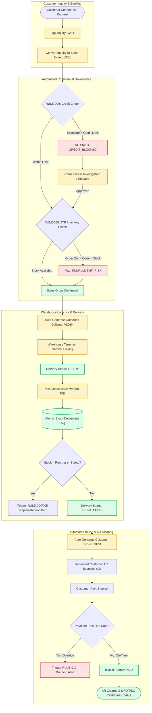

# O2C TO-BE PROCESS MODEL (DIGITAL CONTROL TOWER)
## Enterprise Procure-to-Pay (P2P) & Order-to-Cash (O2C) Digital Control Tower

### To-Be Process Improvements
1. **Real-Time Credit Gate**: Prevents order fulfillment for risky accounts before items are picked.
2. **Automated Available-to-Promise (ATP)**: Gives commercial teams immediate visibility into stock availability, preventing delivery delays.
3. **Streamlined Picking & Post Goods Issue (PGI)**: Movement Type 601 execution guarantees real-time inventory balances and immediate downstream billing availability.
4. **Instantaneous Invoicing**: Invoices are generated electronically upon PGI, reducing DSO by eliminating administrative billing delays.
5. **Automated Dunning Monitoring**: Overdue aging is tracked automatically (`RULE-010`), feeding collection priorities into the O2C Control Tower.
