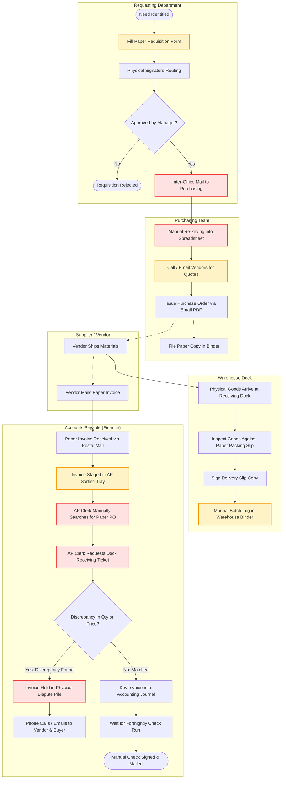

# P2P AS-IS PROCESS MODEL (LEGACY / MANUAL)
## Enterprise Procure-to-Pay (P2P) & Order-to-Cash (O2C) Digital Control Tower

### Critical As-Is Process Inefficiencies
1. **Paper Requisitions & Manual Handoffs**: Requisitions sit on desks awaiting physical signatures with no SLA tracking.
2. **Double-Keying & Transcription Errors**: Purchasing re-enters requisition data into spreadsheets, introducing pricing and quantity errors.
3. **Decoupled Receiving Records**: Deliveries are logged in physical warehouse slips, leaving AP unaware that goods arrived.
4. **Post-Hoc Discrepancy Discovery**: Invoice variances are discovered weeks after shipment, delaying vendor payments and incurring late payment penalties.
5. **No Centralized Exceptions**: Unmatched invoices sit in filing cabinets without escalation workflows.
