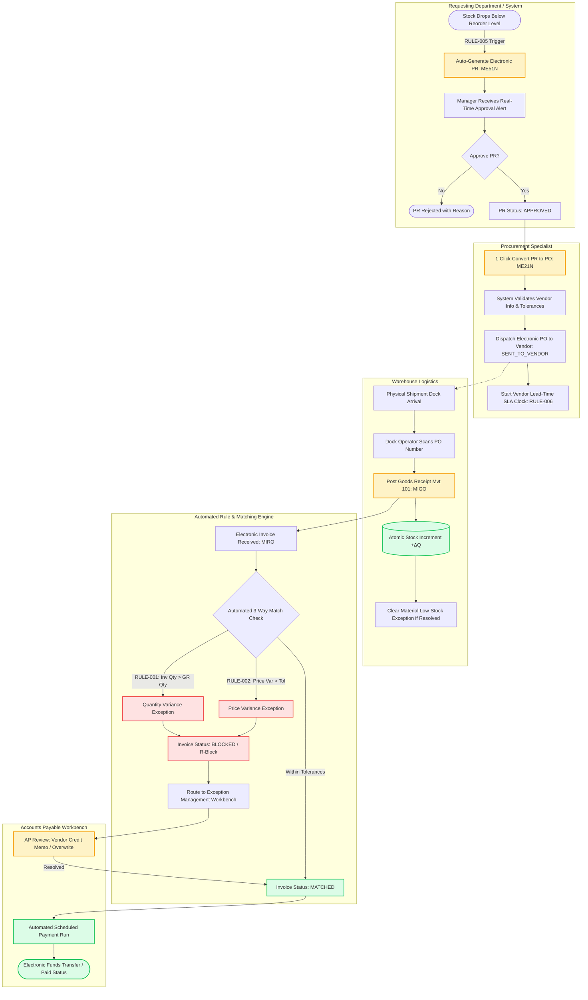

# P2P TO-BE PROCESS MODEL (DIGITAL CONTROL TOWER)
## Enterprise Procure-to-Pay (P2P) & Order-to-Cash (O2C) Digital Control Tower

### To-Be Process Improvements
1. **Automated Requisition Generation**: Integrated with inventory balance alerts (`RULE-004`/`RULE-005`), eliminating stockouts.
2. **Instant PR-to-PO Conversion**: Line items, pricing, and vendor terms carry over with full referential integrity.
3. **Real-Time Stock Updates**: Movement Type 101 updates inventory balances atomically at the storage location level.
4. **Deterministic 3-Way Matching**: Automated line-item reconciliation with instant payment blocks on out-of-tolerance variances.
5. **Centralized Exception Workbench**: Clear assignment, quantitative telemetry, and auditable override resolution paths.
